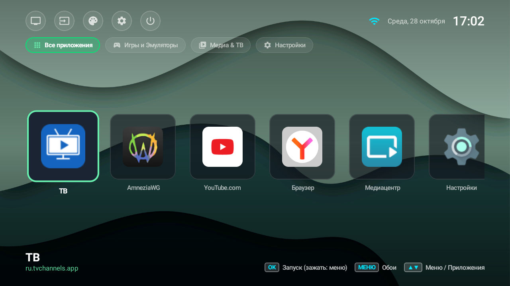

# 📺 XMB Smart TV Launcher

<p align="center">
  
</p>

<p align="center">
  <b>Быстрый, ультра-легковесный и эстетичный лаунчер в стиле XMB / PlayStation для Android TV.</b><br>
  <i>Оптимизирован специально для бюджетных телевизоров со слабым железом (1 ГБ ОЗУ), с нулевой нагрузкой на процессор в простое и нативной интеграцией с ТВ.</i>
</p>

> [!NOTE]
> 🔥 **Вайбкодинг чистой воды:** Этот проект — результат 100% живого вайбкодинга с нейронкой, написанный на чистом энтузиазме, бесконечных тестах прямо на живом слабом телевизоре и желании сделать нормальную, летающую вещь без лагов, рекламы и тяжелого хлама. Всё проверено на реальном железе — оно просто работает и кайфово ощущается.

---

## 🚀 Особенности и фичи

- **⚡ Ультра-низкое потребление ОЗУ и процессора:**
  - Создан специально для бюджетных телевизоров и смарт-приставок (Haier, Yandex TV, Сбер, Xiaomi и др. с объемом памяти $\sim 1$ ГБ).
  - Потребляет всего **$\sim 45-60$ МБ оперативной памяти** (в отличие от стандартных лаунчеров, которые сжирают 250–350+ МБ и уводят ТВ в жесткий своп).
  - Статический шейдерный градиент с **0% нагрузки на CPU/GPU** в режиме покоя — процессор не греется, интерфейс не троттлит.
- **🎮 Навигация в стиле PlayStation / XMB:**
  - Настоящая плавная горизонтальная лента Leanback с автоцентровкой выбранного приложения.
  - Полноценная поддержка пульта ДУ: D-Pad (стрелки), OK / Enter, Назад, Меню.
- **⏱️ Ручная регулировка скорости анимаций:**
  - Точная настройка времени отклика шагами по **20 мс** (влево `◀` быстрее, вправо `▶` плавнее).
  - Быстрое переключение пресетов по клавише OK: `0ms` (мгновенно без задержек), `100ms`, `150ms`, `200ms`, `250ms`, `300ms`.
- **🗂️ Сортировка и скрытие приложений с пульта:**
  - **Зажатие OK (0.5 сек):** открывает компактное меню действий над программой.
  - **Режим перемещения:** стрелками `◀` / `▶` двигайте карточки в начало или между другими программами. Порядок сохраняется автоматически.
  - **Скрытие приложений:** скрывайте ненужный предустановленный софт с экрана (вернуть можно в любой момент через Настройки).
- **🔌 Входы ТВ через локальный сокет ADB:**
  - Встроенный сокетный клиент к локальному порту ADB (`127.0.0.1:5555`).
  - Нажатие на кнопку входов отправляет нативную команду `KEYCODE_TV_INPUT`, вызывая родную выдвижную шторку ТВ (HDMI 1, HDMI 2, AV, TV) без сторонних костылей и без необходимости root-прав.
- **📶 Bluetooth и Пульты:**
  - Мгновенный вызов нативного экрана поиска и сопряжения Bluetooth-аксессуаров Android TV (`CONNECT_INPUT`).
- **🖼️ Кастомные обои и темы:**
  - Встроенные цветовые пресеты с нулевой нагрузкой на видеочип (Классический Синий, Тёмный Графит, Серый Минимал, Неоновый Закат, Изумрудный Лес).
  - Встроенный файловый проводник по любым папкам ТВ (внутренняя память, флешки) для выбора собственных `.png`, `.jpg`, `.webp` с авто-масштабированием для защиты от нехватки памяти (OOM).
- **🕒 Верхняя панель:**
  - Живой статус подключения к Wi-Fi, дата и цифровые часы.

---

## 🕹️ Управление с пульта ДУ

| Кнопка пульта | Действие |
|---|---|
| **Влево / Вправо** | Листание приложений в ленте / точная регулировка миллисекунд в настройках |
| **Вверх / Вниз** | Переход между верхней панелью, категориями и лентой программ |
| **OK / Enter (Короткий клик)** | Запуск выбранного приложения |
| **OK / Enter (Зажатие на 0.5 сек)** | Контекстное меню программы (Переместить, Скрыть, О приложении) |
| **MENU** | Быстрое открытие меню смены тем и обоев |
| **НАЗАД** | Закрытие всплывающих окон и возврат к ленте |

---

## 📥 Установка готового APK

Готовый подписанный APK всегда доступен в разделе [Releases](https://github.com/customizerr7a/xmb-tv-launcher/releases):

1. Скачайте **`xmb-tv-launcher-v1.0-universal.apk`** из последнего релиза.
2. Установите через любой файловый менеджер на ТВ или через ADB с компьютера:
```bash
adb connect <IP_ТЕЛЕВИЗОРА>:5555
adb install -r xmb-tv-launcher-v1.0-universal.apk
```

---

## 🔨 Сборка из исходников

Если хотите собрать самостоятельно:

```bash
git clone https://github.com/customizerr7a/xmb-tv-launcher.git
cd xmb-tv-launcher

# Сборка релизного APK
./gradlew assembleRelease

# Готовый файл появится в:
# app/build/outputs/apk/release/app-release.apk
```

---

## 📄 Лицензия
Распространяется под свободной лицензией [MIT](LICENSE).
